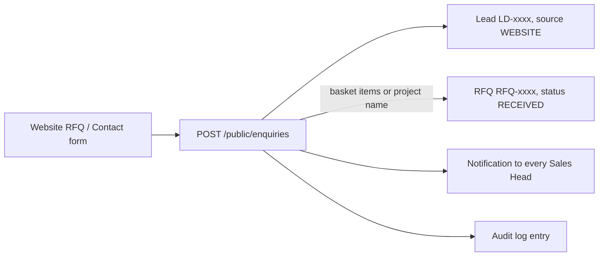

# 2. Public website (http://localhost:3000)

The public website is Fixotec's marketing and technical B2B site. It has **no login**. All its content (products, categories, segments, sectors, news, services, home page blocks) comes from the API and is edited in the ERP under **Website** (`/content`); see file 10. Pages refresh every 5 minutes, so content changes go live without a redeploy. Code: `apps/web`.

If the API is down, the site still shows its header and footer with built-in contact details:
- Fixotec Pipe Supports Pvt. Ltd., 402 Coral Plaza, Wagle Industrial Estate, Thane-400604
- Phone: +91 8692004400 and +91 22 65011065
- Email: info@in.fixotec.global

**Demo mode:** the site may ask for a username (`fixotec`) and password (`DEMO_PASS`). A banner says "Concept demo prepared for Fixotec Pipe Supports Pvt. Ltd. Not the official website."

## 2.1 Navigation

**Top strip (desktop):** the tagline "German-engineered // Made in India", phone numbers, email, and LinkedIn, Instagram, YouTube and Twitter icons.

**Header menu:**

| Menu item | What opens |
|---|---|
| **Products** | Mega menu: every category with its image and sub-categories, plus a "Complete product range in one PDF" panel with **Download catalogue** and **All products** |
| **Segments** | Numbered dropdown: HVAC, Plumbing, Electrical, Fire Fighting, Multiple Services |
| **Sectors** | Mega menu of image tiles in two groups, **Buildings** and **Industries** |
| **Services**, **About**, **News**, **Contact** | Plain links |
| Search icon | Opens `/search` |
| Basket icon with a number | Your **RFQ basket**; opens `/request-quote` |
| **Request a quote** | Opens `/request-quote` |

**Mobile:** the hamburger menu has a search box, collapsible Products, Segments and Sectors sections, links (Services, About, News, Contact, Technical library, Careers), and a **Request a quote** button.

**Footer:** company blurb, social links, up to 7 product categories, company links (About, Services, Segments, Sectors, News, Careers, Technical library), contact details, and **Request a quote** and **Catalogue** buttons.

`/configure` (System finder) and `/projects` are **not linked in the menu**. Type the URL to show them. `/projects` also appears in search results.

## 2.2 Pages, one by one

### Home `/`
Built from content blocks, in this order:
1. A hero with rotating banners.
2. A "Why Fixotec" ticker.
3. Product category cards.
4. "How it's engineered": a scrolling section on load path, corrosion, modularity and install speed.
5. A segment carousel, then sector tiles for Buildings and Industries.
6. A milestones band and service cards.
7. Up to 8 featured products.
8. A catalogue band with **Download PDF** and **Technical library**.
9. Latest news and a call-to-action band.

### Products `/products`
- "Browse by category" tiles appear when no filter is applied.
- The "All products" grid follows.
- The **search box** finds products by name or article number (`?q=`).
- **Segment chips** filter by segment (`?segment=hvac`).

### Category `/products/category/[slug]`
A breadcrumb, a **Request a quote** button, a category sidebar, sub-category tiles or sibling chips, and the product grid.

### Product detail `/products/[slug]`
- Image gallery, category, name, description and segment chips.
- **Spec table:** Finish, Material, Thread, Pipe size, Length, Load capacity, Variants.
- Buttons:
  - **Add variants to RFQ** scrolls to the variants table.
  - **Datasheet** scrolls to the downloads.
  - **Talk to engineering** opens `/contact?topic=<product>` with the message pre-filled.
- Sections: Applications, Features and benefits, the **variants table** (section 2.3), Datasheets, and "You may also need" related products.
- **No prices are shown on the public website.** This is deliberate; pricing happens through the RFQ.

### Segments `/segments` and `/segments/[slug]`
Each segment page has an overview, highlights, "Why Fixotec" benefits, the segment's product range, chips to other segments, and **View products** and **Request a quote** buttons.

### Sectors `/sectors` and `/sectors/[slug]`
Sectors are grouped as Buildings and Industries (for example data centers, hospitals, high-rise, hotels, industrial). Each sector page has:
- A hero image with a **Discuss your project** button, which opens `/request-quote`.
- Recommended products and Applications. Each `##` heading in the sector's CMS text becomes one application.
- Benefits, linked segments, a product grid, and links to other sectors.

### Services `/services`
Service cards from the CMS, a fixed four-step "How we work" section (**Brief, Design, Submit, Install**), feature highlights, and **Talk to an engineer** and **Technical library** buttons.

### Technical library `/resources`
- Catalogue PDF cards.
- A **datasheet library** with a search box (`?q=`) and a product family filter (`?family=`), grouped by family. Every row downloads its file.
- **Clear filters** resets the search and filter.

### Search `/search?q=...`
Results are grouped as **Products**, **Datasheets** (downloaded directly), **Segments and sectors**, **News** and **Projects**. Try "41x41 rail", "pipe clamp" or "seismic".

### System finder `/configure`
A guided product selector (section 2.5).

### Request a quote `/request-quote`
The RFQ form with your basket (section 2.4), a three-step explainer, and a "Prefer to talk? +91 8692004400" call button.

### Contact `/contact`
The head office address with **Open in Google Maps**, phone and email links, social icons, the contact form, and an embedded map. `?topic=` pre-fills the message.

### Other pages
- **About** `/about`: company story chapters, milestones, "What sets us apart", and **Our products** and **Contact us** buttons.
- **Careers** `/careers`: values and openings. **Apply** and **Send your CV** open your email program (mailto). There is no online application form.
- **News** `/news` and `/news/[slug]`: up to 60 posts. Each article has a cover image, body text, **Back to news** and "More news".
- **Projects** `/projects` and `/projects/[slug]`: case studies showing sector, location, year, summary and story.

**Old URLs still work.** Addresses from the old WordPress site, such as `/product/...`, `/product-category/...`, `/about-us`, `/contact-us`, `/career`, `/solutions/*`, `/industries/*` and `/engineering`, redirect to the new pages. This protects SEO.

## 2.3 The variant table and RFQ basket

Every product page lists its **variants**: each size, thickness or finish has its own article number.

1. Use the search box to filter by article number or description.
2. Use the dropdown filters, one per attribute (for example section, thickness, pipe size). A counter shows "N of M" matching variants.
3. Type a **Qty** and click **Add**. The button changes to "Added". Adding the same article again increases its quantity.
4. A footer bar appears: "N articles in your RFQ basket – **Review & send**".

The basket is saved in the browser and stays in sync across tabs. The header basket icon shows the item count. The basket empties after a successful submission.

## 2.4 Forms

### RFQ form (`/request-quote`)
- **Your RFQ basket:** each line shows the product name (a link), article number, an editable **Qty** and a remove button. If the basket is empty, a note says to add articles from product pages or describe the requirement in the text box.
- **Fields:**

| Field | Required? |
|---|---|
| Full name | Yes |
| Company | Yes |
| Email | Yes |
| Phone | No |
| Project name | No |
| Application (HVAC, Plumbing, Electrical, Fire Fighting, Multiple Services, Equipment / AHU supports, Other) | No |
| Requirements (quantities, drawing or BOQ reference, delivery location) | No |

- Click **Submit RFQ**.

### Contact form (`/contact`)
The same fields, but without the basket and Project name. The text field is labelled **Message**. Click **Send message**.

### After submitting
- **Success:** "Thank you. Your RFQ has been received and our sales engineers will respond shortly." In demo mode it adds that the request was recorded in the demo ERP only.
- Two buttons follow: **Continue browsing** and **Send another**.
- **Too many submissions:** "Too many requests from your network…". The limit is 5 per 10 minutes per IP address.
- **Other errors:** the visitor is asked to email info@in.fixotec.global.
- Below the form: "We reply within one working day."

### Spam protection
- A hidden "honeypot" field that bots fill in. If it is filled, the server silently ignores the submission.
- An optional Cloudflare Turnstile CAPTCHA, enabled when `NEXT_PUBLIC_TURNSTILE_SITE_KEY` and `CAPTCHA_SECRET` are set.

### File uploads
**There are none.** Visitors mention their drawing or BOQ reference in the text box. Sales staff can upload BOQs in the ERP (file 6).

## 2.5 System finder (`/configure`)

1. **What are you installing?** (required): Pipes, Cable trays, Ducts, Equipment, Air handling units or Outdoor units.
2. Optional: **Pipe size (mm)**, **Application**, **Installation** (for example Ceiling) and **Environment** (for example Indoor, coastal).
3. Click **Find system**.
4. The result shows "Recommended system: \<name\>" with an ordered list of products and article numbers. Each product links to its page.
5. Click **Add all to RFQ** to put every article in the basket at quantity 1, then **Review RFQ**.
6. If nothing fits: "No standard assembly matches… Contact engineering".

How it decides: rules (`ConfiguratorRule`) are matched by what you are installing, application, installation and pipe-size range, in priority order. The demo has 7 rules. Rules are maintained in the database; there is no ERP screen for them yet.

## 2.6 Downloads

- Catalogues and datasheets can be downloaded from the header, the footer, the home page, `/resources`, product pages and search results.
- **Only documents shared with the `PUBLIC` audience and with an `APPROVED` revision appear on the website.** A draft datasheet never leaks to the public.

## 2.7 What happens in the ERP when someone submits

1. A **Lead** is always created, with source `WEBSITE`. Its status is `RFQ` if there are items or a project name, otherwise `NEW`. It stores name, company, email, phone, application and message.
2. If the visitor had basket items or entered a project name, an **RFQ** is also created with status `RECEIVED`. It has the basket lines (matched to catalogue variants) and is linked to the lead.
3. Every **Sales Head** gets a notification: "Website enquiry: \<company\> sent \<lead number\>".
4. The lead is **not** linked to an existing customer automatically. Sales qualifies it in the ERP.
5. The visitor is not shown the reference number.

## Practice exercise

1. Open a product, filter its variants, and add two articles to the basket.
2. Use the System finder for "Pipes, 100 mm, HVAC" and add the result to the basket.
3. Submit the RFQ.
4. Sign in to the ERP as `saleshead@` and find the new lead in **Leads** and the new RFQ in **RFQs** (the newest one, status Received). Check the notification bell.
