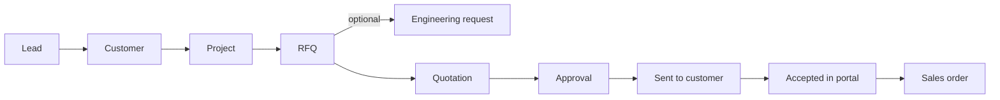
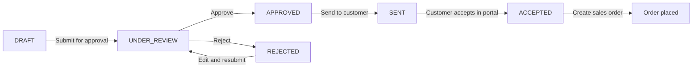
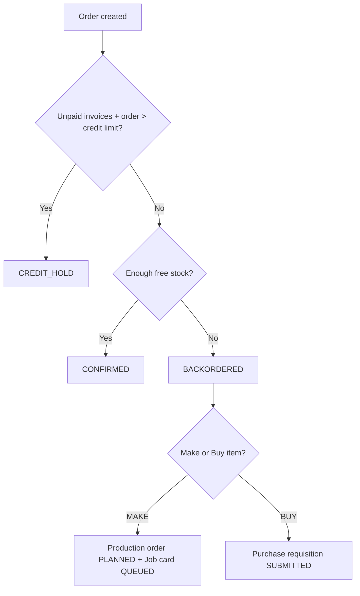

# 5. ERP: Commercial (Leads, Customers, Projects, RFQs, Quotations, Orders)

This section covers the sales cycle, from a lead to a confirmed order:

---

## 5.1 Leads `/leads`

**Permission:** `leads.view`.

**Columns:** Lead, Company, Contact, Source, Value, Owner, Status, Received.

**Status filter:** NEW, QUALIFIED, OPPORTUNITY, PROJECT_IDENTIFIED, RFQ, TECHNICAL_EVALUATION, QUOTATION, NEGOTIATION, WON, LOST.

### How to create a lead
1. Click **New lead**. You need `leads.create`.
2. Fill in:
   - **Company** (required)
   - **Contact** (required)
   - **Source** (required, default PHONE). Options: WEBSITE, LINKEDIN, EXHIBITION, REFERRAL, DISTRIBUTOR, CONSULTANT, GOOGLE, EMAIL, PHONE, WHATSAPP, EXISTING_CUSTOMER.
   - Optional: **Estimated value (INR)**, **Email**, **Phone**, **Application**, **Notes**.
3. Click **Save**. The lead gets a number like `LD-0200`.

### How to move a lead along
1. Open the lead.
2. Click **Update status** (needs `leads.edit`) and choose the new status.

Rules:
- WON and LOST are final; a lead can't move out of them.
- Giving a lead to another owner needs `leads.assign`, and the new owner is notified.

**Leads from the website** arrive automatically with source WEBSITE (see file 2).

---

## 5.2 Customers `/customers`

**Permission:** `customers.view`.

**Columns:** Code, Name, Type, Price list, Projects, Orders, Credit limit, Terms.

### How to create a customer
1. Click **New customer**.
2. Fill in:
   - **Name** (required)
   - **Type** (required). Options: END_CUSTOMER, CONTRACTOR, MEP_CONTRACTOR, CONSULTANT, PMC, ARCHITECT, DEVELOPER, DISTRIBUTOR, DEALER, OEM, GOVERNMENT, EXPORT.
   - Optional: **Price list**, **Email**, **Phone**, **GSTIN**, **Website**, **Credit limit (INR)**, **Payment terms** (default "30 days").
3. Click **Save**. The customer code is `CUS-xxxx`.

The **price list** sets which price column the customer pays:

| Price list | Used for |
|---|---|
| STANDARD | Default price |
| CUSTOMER | Negotiated customer price |
| DEALER | Distributor and dealer price |
| EXPORT | Export price |

**The credit limit** is used by the credit check on every sales order (section 5.6).

The customer detail page is read-only in the UI. Credit limit and price-list changes need `customers.approve` or `customers.override`, and are made through the API.

---

## 5.3 Projects `/projects`

"Manage all customer projects from enquiry to completion." **Permission:** `projects.view`.

### List
- **Tabs:**

| Tab | Project stages |
|---|---|
| All | Every stage |
| Planning | IDENTIFIED, RFQ |
| Engineering | ENGINEERING |
| Commercial | QUOTED, NEGOTIATION |
| Won | WON |
| Site Execution | EXECUTION |
| Completed | CLOSED |

- **Filters:** search, **Stage**, **Health** (On Track, At Risk, Delayed), and a **List/Grid** switch.
- **Columns:** Project (cover image, name, code), Customer, Location, Stage, Value, Progress, Health, Owner, Last activity.
- **Export** downloads `projects.csv`.

### How to create a project
1. Click **Create Project**.
2. Fill in:
   - **Project name** (required, at least 2 characters)
   - **Customer** (required)
   - Optional: **Location**, **Stage** (default IDENTIFIED), **Fixotec value**, **Project value**, **Start date**, **Expected completion**.
3. Click **Save**. The code is `PRJ-xxxx`, and 8 **milestones** are created automatically: Lead, RFQ, Engineering, Quotation, Order, Production, Dispatch, Site.

### Project detail `/projects/[id]`, the project workspace
- **Header:** name, code, health, cover image, customer, location, dates and project value.
- **Edit** (needs `projects.edit`) lets you change:
  - Name, Location, Stage, Fixotec value, Probability %, Start date, Expected completion.
  - **Health override:** Automatic, On Track, At Risk or Delayed.
- **RFQs** button: opens the RFQ list filtered to this project. **Documents** button: opens the Documents tab.

**The 12 tabs:**

| Tab | What it shows |
|---|---|
| Overview | **Project health** (progress %, timeline, budget used, open issues, pending approvals, next milestone, probability); **timeline** milestone stepper; **Key contacts** and parties (consultant, contractor, developer); first 4 documents; recent activity |
| RFQs | RFQ, Application, Status, Lines, Created |
| BOQ | BOQ, Title, Source, Status, Lines |
| Engineering | Request, Application, System, Engineer, Status, Due |
| Quotation | Quotation, Status, Total, Valid until |
| Orders | Order, Status, Total, Lines, Created |
| Production | Production order, Sales order, Status, Qty, Completed |
| Dispatch | Dispatch, Sales order, Status, Transporter, LR no., Shipped, Delivered |
| Site | Issue, Title, Status, Shortage, Raised |
| Documents | File tiles, with an **Upload** button |
| Finance | Invoice, Sales order, Status, Total, Due |
| Activity | Full audit history |

**How health is calculated** (when set to Automatic):
- **DELAYED:** past expected completion and not 100% complete.
- **AT_RISK:** time elapsed is more than 25 percentage points ahead of progress, or 3 or more issues are open.
- **ON_TRACK:** otherwise.

**Stage rules:**
- EXECUTION requires WON first.
- CLOSED requires EXECUTION, WON or LOST first.
- CLOSED is final.

---

## 5.4 RFQs `/rfqs`

An **RFQ** (Request for Quotation) is a customer's request for prices on a list of items. **Permission:** `rfqs.view`.

### List
- **Queue tabs:** **All RFQs**, **Assigned to me**, **Due today**, **Overdue**.
- **Filters:** search (number, application, customer), Status, Priority (LOW, MEDIUM, HIGH, URGENT). Opening the list from a project adds a removable "Project: CODE" chip.
- **Columns:** RFQ, Customer, Project, Application, Lines, Priority, Status, Due, Owner, Received.

### RFQ statuses

| Status | Meaning |
|---|---|
| DRAFT | Created by staff, not yet worked on |
| RECEIVED | Arrived from the portal, website or BOQ |
| UNDER_REVIEW | Being reviewed |
| ENGINEERING_REQUIRED | Waiting on an engineering request |
| PRICING | A quotation has been generated |
| APPROVAL_PENDING | The quotation is in approval |
| QUOTED | Quoted to the customer |
| NEGOTIATION | In negotiation |
| WON / LOST / CANCELLED | Final |

Rules:
- WON is only possible from QUOTED or NEGOTIATION.
- QUOTED is only possible from PRICING, APPROVAL_PENDING or NEGOTIATION.

### How to create an RFQ
1. Click **New RFQ**. You need `rfqs.create`.
2. Fill in:
   - **Customer** (required)
   - **Project** (filtered to that customer)
   - **Application**
   - **Priority** (default Medium)
   - **Due date** (default: 7 days from today)
   - **Notes**
3. Under **Requested items**, for each line:
   - Search the product picker. A matched line is tagged "Catalogue". You can also type free text.
   - Enter **Qty** and **Unit** (default NOS).
   - Click **Add line** for another row.
4. Click **Save**. Staff-created RFQs start as DRAFT.

Lines that are not matched to the catalogue are priced at zero in the quotation, so match them whenever you can.

### RFQ detail `/rfqs/[id]`
- **Header:**
  - Status, priority, and an Overdue or Due today tag.
  - Customer, project link and due date.
  - Estimated or quoted value.
- **Progress stepper** across the RFQ stages.
- **Actions card:**

| Action | Permission | What it does |
|---|---|---|
| **Generate quotation** | quotations.create | Discount %, Freight (INR), Valid for (days, default 15), Delivery terms, Payment terms. Prices come from the customer's price list. Creates a DRAFT quotation and moves the RFQ to PRICING. Warns if lines aren't matched or the customer is missing. |
| **Request engineering review** | engineering.create | Application, Required system, Load, Material, Standard, Due date, Installation condition, Notes. Creates an engineering request and moves the RFQ to ENGINEERING_REQUIRED (from DRAFT, RECEIVED or UNDER_REVIEW). |
| **Update status** | rfqs.edit | New status, plus Notes. The notes replace the existing notes. |
| **Assign owner** | rfqs.edit | Owner, Due date, Priority. The new owner is notified. |
| **Upload document** | documents.create | Attaches a file (default category SPECIFICATION) |

- **Tabs:**
  - **Overview:** customer, code, project, location, received, due, owner, source lead ("Direct" if none), price list, lines, notes.
  - **Requested products:** #, product and article (or "Not matched to catalogue"), specification, qty and unit.
  - **Quotations**, **Engineering** (requests and BOQs), **Documents**, **Activity**.

---

## 5.5 Quotations `/quotations`

**Permission:** `quotations.view`.

### List
- **Tabs:** All, Draft, In approval, Approved, Sent, Accepted.
- **Columns:** Quotation, Customer, Project, RFQ, Discount, Margin (only with the cost permission), Total, Status, Valid until, Created.
- There is **no "New quotation" button**. Quotations are always generated from an RFQ.

### Quotation lifecycle

### Quotation detail `/quotations/[id]`
- **Stepper:** Draft → Approval → Approved → Sent to customer → Accepted → Order placed. REJECTED and CANCELLED show as blocked.
- **Buttons:**

| Button | When it appears | What happens |
|---|---|---|
| **PDF** | quotations.download | Downloads the formal quotation PDF |
| **Submit for approval** | quotations.edit, status DRAFT, REJECTED or NEGOTIATION | Moves to UNDER_REVIEW and opens an approval chosen by the discount (under 10%: Sales Manager; 10-20%: Sales Head; 20% or more: MD). Fails if the quote has no lines or has expired. |
| **Send to customer** | quotations.edit, status APPROVED | Moves to SENT. The customer's portal users are notified and can see it. |
| **Create sales order** | sales_orders.create, status APPROVED, SENT or ACCEPTED, no order yet | Shows a confirmation with customer, lines and value, then creates the sales order at the quoted prices |

- **Notices:** "rejected in approval…" and "Customer accepted on \<date\>".
- **Line items tab:** Item and article, Qty, Rate, Cost (cost permission only), GST %, Amount.
- **Summary:** Subtotal, Discount, Freight, GST, Total. Margin appears with the cost permission and turns **red below 15%**.
- **Terms:** Payment, Delivery, Currency, Created. The default delivery is ex-works Pune, valid 15 days.
- **Sales orders** tab and **Activity** tab.

---

## 5.6 Sales orders `/sales-orders` (sidebar: Orders)

**Permission:** `sales_orders.view`.

- **Tabs:** All, Credit hold, Confirmed, Backordered, Partially shipped, Dispatched.
- **Statuses:** DRAFT, CREDIT_HOLD, CONFIRMED, PARTIAL, BACKORDERED, DISPATCHED, CLOSED, CANCELLED.
- **Columns:** Order, Customer, Project, Quotation (shows "Portal" for distributor orders), Lines, Dispatches, Total, Status, Placed.

### What happens automatically when an order is created

1. **Credit check:** if the customer's unpaid invoices plus this order exceed the credit limit, the order goes to **CREDIT_HOLD**. This is skipped if the creator has `customers.override`.
2. **Stock check:** free stock is stock on hand minus stock reserved for other orders. Any shortfall is **backordered**.
3. For each backordered line:
   - **Manufactured (MAKE) items:** a **production order** and **job card** are created.
   - **Bought-in (BUY) items:** a **purchase requisition** is created.

Staff orders must come from an APPROVED, SENT or ACCEPTED quotation that hasn't expired. You can order part of a quote, but never more than the quoted quantity.

### Sales order detail
- **Release credit hold:** only for status CREDIT_HOLD and users with `customers.override` (Finance Head, MD, Admin). A warning shows exposure vs credit limit.
- **Lines tab:** Item, Ordered, Shipped, Backordered, Rate, Amount.
- **Fulfilment card:** progress %, Subtotal, GST, Total, Credit exposure.
- **Production**, **Dispatch**, **Invoices** and **Activity** tabs.

## Practice exercise (full commercial cycle)

1. As **sales@**, create the lead "Metro Mall" (source EXHIBITION), then create an RFQ for Apex MEP with 2 catalogue lines.
2. As **saleshead@**:
   - Open the RFQ and click **Generate quotation** with a 12% discount.
   - Click **Submit for approval**, then approve it in `/approvals`. You can't approve your own request, so if saleshead@ submitted it, approve as **md@**.
   - Click **Send to customer**.
3. As **customer@apexmep.example** in the portal, accept the quotation.
4. Back in the ERP, click **Create sales order** and note whether it is Confirmed or Backordered, and why.
