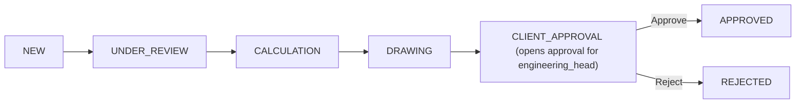

# 6. ERP: Engineering (Engineering, BOQ, Product Library, CAD/BIM, Submittals, Documents)

Fixotec sells engineered support systems. Many RFQs need an engineer to check loads, pick a system and produce drawings before anything is priced. The Engineering section holds that technical work and every technical document that goes with it.

---

## 6.1 Engineering requests `/engineering`

**Permission:** `engineering.view`.

**List:**
- **Status tabs with counts:** All, NEW, UNDER_REVIEW, CALCULATION, DRAWING, CLIENT_APPROVAL, APPROVED, REJECTED.
- **Columns:** Request, Application, System, Project, Rev, Engineer, Status, Due, Raised.
- There is no create button on this page. Requests come from three places:
  - **Request engineering review** on an RFQ (file 5).
  - **New request** in the consultant portal (file 3).
  - The API.
- Request numbers start with `ENQ-`.

### Engineering lifecycle



### Working on a request (`/engineering/[id]`)
1. Open the request. The **stepper** shows New → Under review → Calculation → Drawing → Client approval → Approved.
2. Read the **Design inputs** card: Required system, Load, Dimensions, Material, Installation, Standard, Engineer, Raised, notes.
3. Click **Update** (needs `engineering.edit`). You can change:
   - **Status**
   - **Revision**
   - **Engineer** (assign)
   - **Due date**
   - **Load**
   - **Dimensions**
4. In **Drawings & calculations**, click **Upload** to attach calculations and drawings (default category CALCULATION).
5. When the design is ready, set the status to **Client approval**. This creates an approval for the **Engineering Head**. Approving or rejecting it in `/approvals` sets APPROVED or REJECTED.

You **cannot set APPROVED or REJECTED directly**. Those statuses only come from the approval decision, which keeps an audit trail. Once a request is APPROVED or REJECTED it can't move again.

**Demo tip:** no demo user is Engineering Head, so approve as **md@** or **admin@**. Consultants watch progress in their portal.

---

## 6.2 BOQ (Bill of Quantities) `/boq`

A **BOQ** is a contractor's spreadsheet listing every item and quantity a project needs. Fixotec imports it, matches each line to its own catalogue articles, and turns it into an RFQ. **Permission:** `boq.view`.

**List columns:** BOQ, Title, Project, Source, Lines, Value, Status, Created.

### How to import a BOQ
1. Click **Import BOQ**. You need `boq.create`.
2. Choose a **File**: `.csv`, `.xlsx` or `.pdf`.
   - **CSV or Excel** should have the columns `description`, `qty`, `unit`, `rate`, and optionally `article` (or `sku`).
   - **PDF** files are stored for reference only. No lines are read from them, so enter the lines by hand.
3. Enter a **Title** and choose a **Project** (optional).
4. Click **Save**. Each line is matched to a product by article number or name.

Example CSV:

```csv
description,qty,unit,rate,article
FXR Mounting Rail 41x41 2.0mm,250,M,0,FXR-4141-20
SRS Heavy Clamp 100mm,500,NOS,0,
Threaded Rod M10 1m,800,NOS,0,
```

### BOQ detail `/boq/[id]`
- Pills show the status and "matched/total matched".
- **Lines table:** #, Description with the matched article (or "Not matched"), Qty, Rate, Amount.
- **Convert to RFQ** (needs `rfqs.create`): creates an RFQ with status RECEIVED containing every line, and opens it. This only works if the BOQ has lines, and only **once** per BOQ.

---

## 6.3 Product Library `/products`

The **product master** lists every Fixotec product with engineering detail. **Permission:** `products.view`.

**Filters:**
- Search by name, SKU or article number.
- **Category**, **Family**, and **Supply** (Manufactured or Traded).
- A Grid/List switch, with 24 products per page.

**Grid cards:** image, an "Internal" badge if the product isn't published on the website, name, SKU, applications, number of variants, and "from ₹" or "Price on request".

**List columns:** Product, Category, Family, Material, Supply, Variants, From, Website (Published or Internal).

### Product detail `/products/[id]`
- **Header:**
  - Image gallery.
  - SKU, and badges for Manufactured or Traded and On website or Internal only.
  - Description, "Price from", and the variant count.
- **Specifications:** Category, Family, Material, Coating, Finish, Load capacity, Thread, Pipe size, Length, Weight, HSN / GST, Lead time, MOQ, Revision.
- **Buttons:**
  - **Datasheet** downloads the product's datasheet.
  - **Add to RFQ** opens a new RFQ with this product already filled in.
- **Tabs:**

| Tab | Content |
|---|---|
| Overview | Technical description and features |
| Variants | Every article: Article no., Variant, attribute columns (for example 41×41, 2.0 mm), Price, and **+ RFQ** per row |
| Applications | Applications, segments and sectors |
| CAD / BIM | CAD and BIM files, with **Upload** |
| Documents | All files, with **Upload** |
| Pricing | Standard, Customer, Dealer and Export prices. **Cost** and **Std margin** appear only with `products.view_cost`; margin turns red below 15% |

**Variant engine:** one product, such as the FXR Mounting Rail, has many variants. Each is a combination of attributes (section and thickness) with its own **article number**, such as FXR-4141-20. Orders, stock and prices are all held per variant.

Products are created through the API (`POST /products`, `/products/:id/variants`). Website-facing fields are edited in **Website** (file 10).

---

## 6.4 CAD / BIM library `/cad`

**Permission:** `documents.view`.

- **Tabs:** All files, CAD (DWG/DXF), BIM models, Drawings.
- **Filters:** search, **Project**, and a Grid/List switch.
- **List columns:** File, Type, Linked to, Rev, Status, Size, Updated, Download.
- **Upload file** (needs `documents.create`). If a project filter is active, the file is linked to that project.

---

## 6.5 Technical submittals `/submittals`

A **technical submittal** is the formal package a contractor or consultant must approve before products go on site. It holds datasheets, certificates, drawings and specifications. Fixotec builds it as **one compiled PDF**.

**List:**
- **Filters:** Project, Status (Draft, Submitted, Approved, Approved as noted, Rejected).
- **Columns:** Submittal, Title, Project, Contents ("N products · N documents"), Status, Created.
- Click a row to open a side drawer with status, project, products, documents and every revision, each with a download button.

### How to compile a submittal
1. Click **New submittal**. You need `engineering.create`.
2. Choose the **Project** (required) and enter a **Title** (required).
3. Tick the **project documents** to include (drawings, certificates and so on).
4. Tick the **product variants** to include. Their product data is added.
5. Click **Compile PDF**. The combined PDF is generated and downloaded.

The submittal is saved as a SUBMITTAL document (number `SUB-xxxx`) and shared with the customer and consultant, so it appears in their portals.

---

## 6.6 Documents `/documents`

The **central document repository** for every file in the system. **Permission:** `documents.view`.

**Columns:** Title, Category, Linked to, Revisions, Updated, and a download icon.

### How to upload a document
1. Click **Upload**. You need `documents.create`. The same upload form appears on RFQs, projects, products and engineering requests.
2. Fill in:
   - **File** (required, up to 25 MB). The real file type is checked, not just its name. Allowed types: PDF, PNG, JPG, WEBP, GIF, ZIP, XLSX, DOCX, DWG, DXF, RVT, IFC/STEP, CSV and TXT.
   - **Title** (defaults to the file name).
   - **Category**: DRAWING, CAD, BIM, SUBMITTAL, CALCULATION, SPECIFICATION, DATASHEET, CERTIFICATE, INSTALLATION, QC or OTHER.
   - **Share with**: comma-separated audiences. The default is `CUSTOMER,CONSULTANT`. Options: PUBLIC, CUSTOMER, DISTRIBUTOR, DEALER, CONSULTANT, CONTRACTOR.
3. Click **Save**. Images get a preview thumbnail automatically.

### Versions and approval

| Version status | Meaning |
|---|---|
| DRAFT | Just uploaded |
| INTERNAL_REVIEW | Fixotec is checking it |
| CLIENT_REVIEW | Shared with the client for review (visible in the portal) |
| APPROVED | Final and frozen (visible in the portal; on the website if PUBLIC) |

Rules:
- An **approved version can never be overwritten**. To change it, upload a new version.
- **You cannot approve a version you uploaded yourself.**
- Portal users only see APPROVED and CLIENT_REVIEW versions, and only for audiences that match them.
- The website only shows PUBLIC documents with an APPROVED version.

### Share links and archiving
These are available through the API:
- **Share links:** a secure link valid for 1 to 30 days (default 7). It can be revoked at any time.
- **Archiving:** hides a document and revokes all its share links.

## Practice exercise

1. As **engineer@**, open ENQ-0100, move it to CALCULATION and upload a PDF calculation.
2. Move it to CLIENT_APPROVAL, then approve it as **md@**.
3. Save the example CSV above as `boq.csv`, import it against "ABC Data Center", and check the matched count.
4. Click **Convert to RFQ**.
5. Create a technical submittal for ABC Data Center with the FXR-4141-20 variant, and download the PDF.
