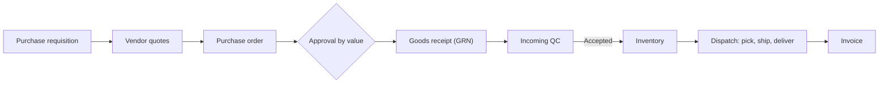
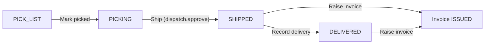

# 7. ERP: Supply chain (Vendors, Purchases, Warehouses, Inventory, Dispatch)

This section covers buying material, storing it, tracking stock and shipping goods to customers.

---

## 7.1 Vendors `/vendors`

**Permission:** `vendors.view`.

**Columns:** Code, Name, GSTIN, Lead time (d), Quality /5, On-time %, Terms.

### How to create a vendor
1. Click **New vendor**. You need `vendors.create`.
2. Fill in:
   - **Name** (required)
   - Optional: **GSTIN**, **Payment terms**, **Email**, **Phone**, **Lead time (days)** (default 14), **Categories** (comma-separated, for example "steel, coating")
3. Click **Save**. The code is `VEN-xxxx`.

**Demo data:** VEN-STEEL, Deccan Coil Processors.

---

## 7.2 Purchases `/purchases`

**Permission:** `purchases.view`. This screen is **read-only in the current ERP**.

- **Mini stats:** Open requisitions, Open purchase orders, Open PO value.
- **Purchase orders tab:** PO, Vendor, Lines, GRNs, Total, Status, Expected, Raised.
- **Requisitions tab:** Requisition, Lines, Vendor quotes, POs, Status, Needed by, Raised.

**Where purchase records come from:**
- **Purchase requisitions (PR-xxxx)** are created automatically when a sales order backorders a bought-in item (file 5), and by the **MRP run** (file 8). They can also be created through the API.
- **Purchase orders (PO-xxxx)** are created through the API (`POST /purchases/orders`).
  - New POs start as SUBMITTED, and an approval request opens: over ₹5 lakh goes to the Procurement Manager, over ₹20 lakh to the MD.
  - If no rule matches and the value is within the buyer's authority (₹5 lakh by default), the PO is approved automatically and procurement is notified.
  - Decide PO approvals in `/approvals`.
- **Goods receipts (GRN-xxxx)** are recorded through the API when material arrives:
  - The PO must be APPROVED or PARTIAL.
  - Up to 5% over-delivery is allowed.
  - The receipt is created with status QC, and one **incoming inspection** per line appears in **Quality** (file 8).
  - **Stock is not added until QC accepts the material.**

**Demo data:** PO-0100 (Approved).

Create screens for requisitions, POs and goods receipts are not built yet; see file 13. In a demo, show the lists and explain the flow, or create records through Swagger (`/api/docs`).

---

## 7.3 Warehouses `/warehouses`

**Permission:** `warehouses.view`.

**Columns:** Code, Name, Plant, Bins, Address.

### How to create a warehouse
1. Click **New warehouse**.
2. Enter a **Code** and **Name** (both required), and optionally an **Address**.
3. Click **Save**.

**Bins and zones:** bins are added through the API. Every bin belongs to one zone:

| Zone | Holds |
|---|---|
| RAW | Raw material |
| WIP | Work in progress |
| FG | Finished goods |
| QC_HOLD | Material waiting for inspection |
| REJECTED | Rejected material |
| SCRAP | Scrap |

**Demo data:** WH-PUN, with one bin per zone.

---

## 7.4 Inventory `/inventory`

**Permission:** `inventory.view`. The description reads: "Quantities change only through transactions."

- **Mini stats:**
  - Stock positions.
  - Articles below safety stock.
  - Inventory value (only with `products.view_cost`).
- **Filters:** search (article, product, bin), **Warehouse**, **Stock level** ("Below safety stock").
- **Columns:** Article, Item, Warehouse, Bin, Batch, On hand, Level, Value (cost permission only).
  - **Level** shows Out, Below safety, or OK.

### Key inventory principles (good demo talking points)
- **Nobody edits stock numbers directly.** Every movement is a **transaction** in a ledger: opening stock, purchase receipt, production receipt, sale/dispatch, transfer, adjustment, scrap, return or consumption. This gives a full audit trail.
- **Stock cannot go negative** unless the user has `inventory.override` (the Warehouse Manager does).
- **Valuation** uses **weighted-average cost**.
- **Batch tracking:** each stock position can carry a batch number, which supports traceability.
- When stock drops **below the reorder level**, a `StockBelowReorder` event is recorded. The alert scan notifies the Warehouse Manager.
- Distributors only see availability bands, never exact quantities (file 3).
- Transfers between bins or warehouses and manual adjustments are done through the API (`/inventory/transactions`, `/inventory/transfers`).

---

## 7.5 Dispatch `/dispatch`

**Permission:** `dispatch.view`.

**Columns:** Dispatch, Sales order, Customer, From, Transporter, LR no., Status, Shipped, Delivered.

### Dispatch lifecycle

**Creating a dispatch:** a pick list (`DSP-xxxx`) is created through the API for an order that is CONFIRMED, PARTIAL or BACKORDERED.

### How to process a dispatch
1. Open the dispatch from `/dispatch`.
2. Click **Mark picked** (needs `dispatch.edit`). Every line is marked fully picked, and the status becomes PICKING.
3. Click **Ship** (needs `dispatch.approve`). Fill in:
   - **Transporter**
   - **LR number** (the lorry receipt from the transporter)
   - **E-way bill** (the GST transport document reference)
   - **Vehicle no.**

   On shipping:
   - Stock is deducted from the **FG** bin.
   - The sales order lines are marked shipped. The order becomes PARTIAL or DISPATCHED.
   - The customer sees the shipment in their portal under Deliveries.
4. Click **Record delivery** (needs `dispatch.edit`) and add a **proof-of-delivery** note. The status becomes DELIVERED.
5. Click **Raise invoice** (needs `invoices.create`) when the dispatch is SHIPPED or DELIVERED. One invoice is created per dispatch, with status ISSUED and due in 30 days (file 9).

Partial dispatch is supported: an order can have several dispatches, and each one gets its own invoice.

## Practice exercise

1. As **purchase@**, create a vendor "Shree Coatings" with categories "coating, galvanizing".
2. As **warehouse@**, open Inventory, filter **Below safety stock**, and note which articles are low.
3. Open a dispatch that is in PICK_LIST or PICKING. Mark it picked, ship it with a made-up LR number, then raise the invoice.
4. As **customer@apexmep.example** in the portal, find the shipment under **Deliveries** and the invoice under **Invoices**.
