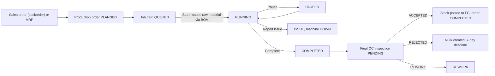

# 8. ERP: Plant (Production, Shop Floor, MRP, Quality, Non-conformance)

This section covers how Fixotec manufactures products, checks their quality, and handles defects.



---

## 8.1 Production `/production`

**Permission:** `production.view`. This is a read-only list and detail view.

- **Columns:** Order, Machine, Qty, Completed, Job cards, Status, Planned start.
- **Status filter:**

| Status | Meaning |
|---|---|
| PLANNED | Created, not yet released |
| RELEASED | Released to the floor |
| IN_PROGRESS | First job card started |
| QC | Production finished; final inspection pending |
| COMPLETED | QC accepted; stock is in FG |
| CANCELLED | Cancelled |

**Where production orders (PRD-xxxx) come from:**
1. **Automatically**, when a sales order backorders a manufactured (MAKE) item (file 5). A job card (JOB-xxxx) is created at the same time.
2. From the **MRP run** (section 8.3).
3. Through the API (`POST /production`).

**Supporting setup (API):**
- **BOM** (`/bom`): the bill of materials. It lists the raw materials per finished unit, with scrap % and yield. For example, FXR-4141-20 uses steel coil plus zinc coating.
- **Work centres** (`/work-centers`) and **machines** (`/machines`). The demo has WC-FAB with LASER-01, PRESS-01, CNC-02 and LASER-02.
- **Planning board** (`GET /production/board`): machine-by-day loading. **Roadmap:** a visual board screen.

**Demo data:** PRD-0100 with JOB-0100.

---

## 8.2 Shop Floor `/shop`

"Job cards for operators." This is a large-button, tablet-friendly screen for machine operators. **Permission:** `production.edit` (Production Manager, Production Supervisor, Admin, MD).

- **Tabs:** **Active** (QUEUED, RUNNING, PAUSED), **Completed**, **All**.
- **Each job card shows:**
  - Job number, production order number, machine and status.
  - A big "done / required" counter and a progress bar.
  - Start time, downtime minutes, and any issue note.

### How an operator runs a job
1. Find the job card under **Active**.
2. Click **Start**. On the **first** start, the system:
   - Works out the raw material needed from the **BOM**, including scrap and yield.
   - **Issues that material from the RAW bin** as an inventory transaction.
   - **Refuses to start** if material is short, and lists what is missing.
   - Sets the job to RUNNING, the production order to IN_PROGRESS, and the machine to RUNNING.
3. Click **Pause** to stop temporarily. The job goes to PAUSED and **15 minutes of downtime** is logged. Click **Start** again to resume.
4. If something goes wrong, click **Report issue**. The job goes to ISSUE, the machine goes to DOWN, and the note "Reported from the floor" is saved.
5. Click **Complete** when finished. On this screen it records the **full required quantity**. Through the API, any quantity up to 110% of required is allowed.
   - The job becomes COMPLETED.
   - The production order moves to **QC**.
   - A **final inspection** appears in Quality.

---

## 8.3 MRP (Material Requirements Planning)

MRP is run through the API (`POST /mrp/run`). There is no button in the ERP yet. It calculates, for each item:

```text
Net requirement = Open order demand
                - Stock on hand
                - Open purchase orders
                - Production in progress
                - Open requisitions
                + Safety stock
```

For every item with a positive net requirement:
- **MAKE** items get **production orders**.
- **BUY** items get **purchase requisitions**.

Only one MRP run can happen at a time. Each run records an `MrpRun` event.

---

## 8.4 Quality `/quality`

**Permission:** `quality.view`.

- **Columns:** Inspection, Stage, GRN, Production, Batch, Status, Raised.
- **Status filter:** PENDING, ACCEPTED, REJECTED, REWORK.

**Types of inspection (QC-xxxx):**

| Stage | Created when | Linked to |
|---|---|---|
| Incoming | A goods receipt is recorded (one per line) | GRN |
| Final | A job card is completed | Production order |
| In-process | Through the API | Production order |

### How to record a QC decision
1. Open a PENDING inspection.
2. Click **Record decision** (needs `quality.approve`).
3. Choose a **Decision** (required) and add **Notes**.
4. Click **Save**. What happens depends on the decision:

| Decision | Goods receipt inspection | Production inspection |
|---|---|---|
| **ACCEPTED** | Stock posted to RAW or FG; GRN becomes POSTED | Stock posted to FG; production order becomes COMPLETED |
| **REJECTED** | GRN becomes REJECTED; **NCR created** (7-day deadline) | **NCR created** (7-day deadline) |
| **REWORK** | Marked REWORK; no stock posted | Marked REWORK; no stock posted |

**This is the key control:** stock only enters inventory after QC accepts it. That gives complete quality traceability.

---

## 8.5 Non-conformance (NCR) `/ncr`

An **NCR** (Non-Conformance Report) records a quality failure and its fix, called **CAPA** (Corrective And Preventive Action). **Permission:** `ncr.view`.

- **Columns:** NCR, Issue, Vendor, Status, Deadline, Raised.
- **Statuses:** OPEN → INVESTIGATING → ACTION_REQUIRED → CLOSED.

### How to handle an NCR
1. Open the NCR. Rejected QC inspections create one automatically.
2. Click **Update CAPA** (needs `ncr.edit`) and fill in:
   - **Status** (required)
   - **Deadline**
   - **Root cause**: why it happened
   - **Corrective action**: how the current problem is fixed
   - **Preventive action**: how it is stopped from happening again
3. Click **Save**.

Rules:
- An NCR **cannot be closed without a corrective action**.
- CLOSED is final.

## Practice exercise

1. As **production@**, open **Shop Floor** and start JOB-0100. If it refuses, read the material shortage list; it shows that BOM-based material issue works.
2. Pause it, start it again, then click **Complete**.
3. As **qc@**, find the new final inspection in **Quality** and REJECT it with a note.
4. Open the new NCR. Try to set CLOSED without a corrective action and see the error. Then fill in the root cause and corrective action, and close it.
