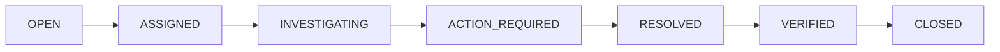
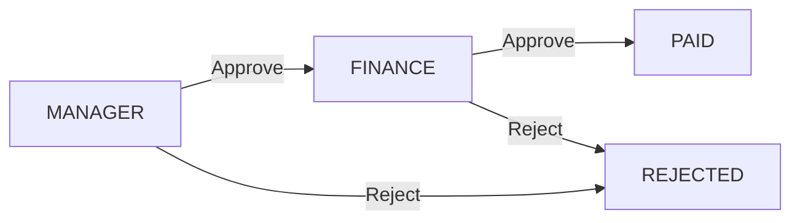

# 9. ERP: Field & finance (Site Execution, Service, Invoices, Payments, Expenses)

---

## 9.1 Site Execution `/sites`

This screen tracks **site issues**: problems found during installation at a customer's project site. **Permission:** `sites.view`.

- **Columns:** Issue, Title, Project, Shortage, Owner, Status, Raised.

### Site issue lifecycle

- An issue raised with an assignee starts as ASSIGNED.
- VERIFIED requires RESOLVED first.
- CLOSED is final.

### How to raise a site issue
1. Click **Raise issue**. You need `sites.create`.
2. Fill in:
   - **Project** (required)
   - **Title** (required)
   - **Description**
   - **Material shortage** checkbox: tick it when the issue is missing material.
3. Click **Save**. The number is `ISS-xxxx`.
4. Later, use **Update status** (needs `sites.edit`) to move it along and update the description.

Open issues count towards **project health**: 3 or more open issues make a project At Risk. The Assistant also lists them when you ask "why is \<project\> delayed".

### Other site features (API, for the future mobile app)
- **Site visits:** check in with GPS coordinates, then check out (`/sites/visits`).
- **Site reports:** labour hours, the name of the client contact who signed off, and material consumed (`/sites/reports`).
- **Roadmap:** a mobile-first site app with photos, drawings, and client signature capture on screen.

**Demo data:** ISS-0100.

---

## 9.2 Service `/service`

This screen holds **service tickets** (customer complaints and support requests). **Permission:** `service.view`.

- **Columns:** Ticket, Subject, Customer, Priority, Owner, Status, SLA due.
- **Statuses:** the same as site issues: OPEN, ASSIGNED, INVESTIGATING, ACTION_REQUIRED, RESOLVED, VERIFIED, CLOSED.

### SLA (response deadline) by priority

| Priority | Respond within |
|---|---|
| CRITICAL | 4 hours |
| HIGH | 8 hours |
| MEDIUM | 24 hours |
| LOW | 48 hours |

These hours are a setting (`sla`), so management can change them (file 10, Organization).

### How to work a ticket
1. Click **New ticket** (needs `service.create`). Fill in:
   - **Subject** (required)
   - **Customer**
   - **Priority** (default MEDIUM)
   - **Description**

   Customers can also raise tickets themselves from the portal's **Support** page.
2. Open the ticket and click **Update ticket** (needs `service.edit`) to change the **Status** and **Priority**.
3. Comments go in the ticket conversation (API `POST /service/tickets/:id/comments`). The customer sees them in the portal.
4. Closed tickets cannot take more comments.

**Demo data:** TKT-0100 (HIGH priority).

---

## 9.3 Invoices `/invoices`

**Permission:** `invoices.view`. Read-only list and detail.

- **Columns:** Invoice, Customer, Total, Payments, Status, Due, Issued.
- **Statuses:**

| Status | Meaning |
|---|---|
| DRAFT | Not yet issued |
| ISSUED | Sent; nothing paid yet |
| PARTIAL | Partly paid |
| PAID | Fully paid |
| OVERDUE | Past the due date with money owed |
| CANCELLED | Cancelled |

**How invoices are created:** open a **SHIPPED** or **DELIVERED** dispatch and click **Raise invoice** (file 7).
- You get one invoice (`INV-xxxx`) per dispatch.
- It is created as ISSUED, due in **30 days**.
- The customer sees it in the portal under **Invoices**.

**Overdue alerts:** the hourly scan notifies the **Finance Head** about overdue invoices.

**Accounting export:** `POST /finance/sync` sends invoices to **Tally** or **Zoho Books** (`ACCOUNTING_TARGET`). If that isn't configured, the data is stored with status NOT_CONFIGURED, ready to send later. Fixotec ONE is designed to sit alongside the accounting package, not to replace it.

---

## 9.4 Payments (API)

Payments (`PMT-xxxx`) are recorded through `POST /payments`. They have no ERP screen yet.
- **Incoming** payments settle customer invoices. The invoice automatically becomes PARTIAL or PAID.
- **Outgoing** payments settle **vendor bills** (`VB-xxxx`, created through `POST /finance/bills`).
- **Overpayment is blocked.**
- Payables are listed at `GET /finance/payables`.

The portal's Invoices page shows each invoice's balance, so customers see payments as soon as they are recorded.

---

## 9.5 Expenses `/expenses`

These are employee expense claims. **Permission:** `expenses.view`.

- **Columns:** Claim, Employee, Category, Amount, Stage, Spent on.
- **Approval stages:**

### How to submit and approve a claim
1. Click **New claim** (needs `expenses.create`). Fill in:
   - **Category** (required): TRAVEL, FUEL, HOTEL, FOOD, CLIENT_MEETING, SITE, PURCHASE or OTHER
   - **Amount** (required)
   - **Spent on** (date)
   - **Description**
2. Click **Save**. The claim (`EXP-xxxx`) starts at the **MANAGER** stage.
3. An approver (needs `expenses.approve`) opens the claim and clicks **Approve** to move it to the next stage (MANAGER, then FINANCE, then PAID), or **Reject**.
4. **You cannot approve your own expense.**

**Demo-data catch:** a claim is filed for *your own* employee record. In the seed, only **sales@** (EMP-001) and **site@** (EMP-002) are linked to employee records, and neither role has `expenses.create`. Admin and MD have the permission but no employee record, so they get "Your user is not linked to an employee record". To demo expenses:
1. As **admin@**, open **Roles**, give `sales_executive` the `expenses.create` permission, and click **Save changes**.
2. Sign in as **sales@** and submit the claim.
3. Approve it as **finance@** twice.

## Practice exercise

1. As **site@**, raise a site issue on "ABC Data Center" with **Material shortage** ticked. Move it to INVESTIGATING.
2. As **admin@**, create a CRITICAL service ticket for Apex MEP and check that the SLA due time is 4 hours from now.
3. Follow the "Demo-data catch" steps in section 9.5. As **sales@**, submit a ₹2,500 TRAVEL claim. As **finance@**, approve it twice: MANAGER to FINANCE, then FINANCE to PAID.
4. Open an invoice and read its status and due date.
