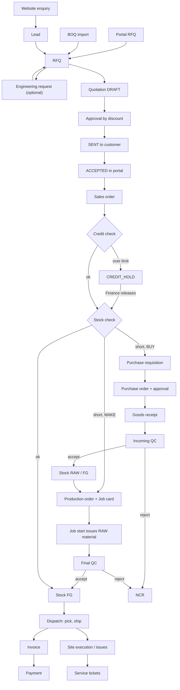

# 11. Business rules, automatic flows and integrations

This file explains how the platform behaves underneath the screens. Knowing it lets you answer "what happens if…" questions with confidence.

## 11.1 The complete business flow

## 11.2 Status machines (rules from `packages/shared/src/index.ts`)

| Record | Statuses | Key rules |
|---|---|---|
| Lead | NEW, QUALIFIED, OPPORTUNITY, PROJECT_IDENTIFIED, RFQ, TECHNICAL_EVALUATION, QUOTATION, NEGOTIATION, WON, LOST | WON and LOST are final |
| Project | IDENTIFIED, RFQ, ENGINEERING, QUOTED, NEGOTIATION, WON, EXECUTION, CLOSED, LOST | EXECUTION needs WON first. CLOSED needs EXECUTION, WON or LOST first. CLOSED is final |
| RFQ | DRAFT, RECEIVED, UNDER_REVIEW, ENGINEERING_REQUIRED, PRICING, APPROVAL_PENDING, QUOTED, NEGOTIATION, WON, LOST, CANCELLED | WON only from QUOTED or NEGOTIATION. QUOTED only from PRICING, APPROVAL_PENDING or NEGOTIATION. WON, LOST and CANCELLED are final |
| Quotation | DRAFT, SUBMITTED, UNDER_REVIEW, APPROVED, REJECTED, SENT, ACCEPTED, NEGOTIATION, CANCELLED, COMPLETED | Submit from DRAFT, REJECTED or NEGOTIATION. Send only from APPROVED. Accept (portal only) from SENT or NEGOTIATION, before expiry |
| Sales order | DRAFT, CREDIT_HOLD, CONFIRMED, PARTIAL, BACKORDERED, DISPATCHED, CLOSED, CANCELLED | Set by the credit check, stock check and dispatches |
| Engineering request | NEW, UNDER_REVIEW, CALCULATION, DRAWING, CLIENT_APPROVAL, APPROVED, REJECTED | APPROVED and REJECTED come only from an approval decision, and are final |
| Purchase order | SUBMITTED, APPROVED, REJECTED, PARTIAL, … | Approval by value; auto-approved within the buyer's authority |
| Goods receipt | QC, POSTED, REJECTED | Stock is added only when QC accepts |
| Production order | PLANNED, RELEASED, IN_PROGRESS, QC, COMPLETED, CANCELLED | QC acceptance completes it |
| Job card | QUEUED, RUNNING, PAUSED, ISSUE, COMPLETED | Start needs raw material. Completion is capped at 110% of the required quantity |
| QC inspection | PENDING, ACCEPTED, REJECTED, REWORK | REJECTED creates an NCR |
| NCR | OPEN, INVESTIGATING, ACTION_REQUIRED, CLOSED | Can't close without a corrective action |
| Dispatch | PICK_LIST, PICKING, SHIPPED, DELIVERED | Ship needs `dispatch.approve` and deducts FG stock |
| Invoice | DRAFT, ISSUED, PARTIAL, PAID, OVERDUE, CANCELLED | Status follows payments |
| Site issue / service ticket | OPEN, ASSIGNED, INVESTIGATING, ACTION_REQUIRED, RESOLVED, VERIFIED, CLOSED | VERIFIED needs RESOLVED first. CLOSED is final, and closed tickets take no comments |
| Expense | MANAGER, FINANCE, PAID, REJECTED | Two approvals. You can't approve your own |
| Document version | DRAFT, INTERNAL_REVIEW, CLIENT_REVIEW, APPROVED | APPROVED is frozen. You can't approve your own upload |

Every status change is stored in the **workflow history**, with who made it, when, and the comment.

## 11.3 Automatic numbering

Each record type has a prefix and a 4-digit number. The number is assigned inside the same database transaction as the record, so failed saves leave no gaps.

| Prefix | Record | Prefix | Record |
|---|---|---|---|
| LD- | Lead | GRN- | Goods receipt |
| PRJ- | Project | PRD- | Production order |
| RFQ- | RFQ | JOB- | Job card |
| QT- | Quotation | QC- | Quality inspection |
| SO- | Sales order | NCR- | Non-conformance |
| PR- | Purchase requisition | DSP- | Dispatch |
| PO- | Purchase order | INV- | Invoice |
| ENQ- | Engineering request | PMT- | Payment |
| BOQ- | Bill of quantities | VB- | Vendor bill |
| SUB- | Submittal | EXP- | Expense |
| TKT- | Service ticket | ISS- | Site issue |
| CUS- | Customer | VEN- | Vendor |

The seed records use 0100 to 0107. **New records start at 0200.**

## 11.4 Pricing rules

- Every product variant has **Standard, Customer, Dealer and Export** prices, plus purchase or manufacturing cost.
- A customer's **price list** decides which price applies. It is used for quotations generated from RFQs and for distributor orders.
- Distributor order prices are always recalculated on the server, so the browser can never change a price.
- **Cost and margin** are only shown to roles with `products.view_cost`. Portal users never see costs or other customers' prices.
- On quotations, a margin below 15% is shown in red as a warning.
- Defaults: quotations are valid for 15 days, delivered ex-works Pune. Invoices are due in 30 days.

## 11.5 Approval engine

- Rules are stored in the database (`/approval-rules`), not fixed in code. Each rule has an entity, conditions (for example discount at least 10 and below 20) and an approver role.
- Rules are checked in **priority order, and the first match wins**.
- Nobody can approve their own request. The named role, or MD, CEO or Super Admin, decides.
- A decision automatically moves the linked record forward (file 4, section 4.4).
- The seeded rules are listed in file 1, section 1.5.

## 11.6 Inventory rules

- Stock changes **only through transactions**: opening stock, purchase receipt, production receipt, sale, transfer, adjustment, scrap, return or consumption. Nobody can type over a stock number.
- Stock can't go negative without `inventory.override`.
- Stock is valued at weighted-average cost.
- "Free stock" is stock on hand minus stock reserved for other orders. The sales order stock check uses free stock.
- Dropping below the reorder level records a `StockBelowReorder` event and triggers an alert.
- Distributors see availability bands only: AVAILABLE, LIMITED, OUT_OF_STOCK or MADE_TO_ORDER.

## 11.7 Project health and milestones

- **8 milestones** are created for every project: Lead, RFQ, Engineering, Quotation, Order, Production, Dispatch, Site. They are ticked automatically as the stage moves forward.
- **Health** is worked out automatically, unless someone overrides it:
  - **DELAYED:** past expected completion and not 100% complete.
  - **AT_RISK:** time elapsed is more than 25 percentage points ahead of progress, or 3 or more issues are open.
  - **ON_TRACK:** otherwise.

## 11.8 Domain events

Key moments are stored as events for audit and for future integrations:
- `SalesOrderCreated`, `ProductionRequirementCreated`, `PurchaseRequestCreated`
- `GoodsReceived`, `QCRequired`, `QCApproved`, `InventoryUpdated`
- `DispatchShipped`, `StockBelowReorder`, `MrpRun`

Today the follow-up work happens straight away in the same transaction, so nothing gets out of sync. The stored events are ready for webhooks or analytics later.

## 11.9 Background jobs and notifications

- **Hourly alert scan** (BullMQ queue `fixotec`; needs Redis). Failed jobs retry 5 times, then move to a dead-letter queue. It sends:
  - Items below safety stock: Warehouse Manager.
  - Overdue invoices: Finance Head.
  - Projects past expected completion: Project Manager.
- **Manual run:** **Scan for alerts** on `/notifications` (admin).
- **Channels:**
  - In-app (bell and Notifications page).
  - Email when SMTP is configured.
  - **WhatsApp, SMS and push: Roadmap.** WHATSAPP exists only as a lead source today.

## 11.10 Security features

| Feature | Detail |
|---|---|
| Passwords | At least 10 characters with uppercase, lowercase and a number. Securely hashed |
| Lockout | After 5 failures; the lock doubles each time, up to 60 minutes |
| Two-step verification | Authenticator app (TOTP) plus `XXXX-XXXX` recovery codes. Secrets are encrypted at rest |
| Sessions | 8 hours, checked against the database on every call. Changing a password signs out other sessions |
| Single sign-on | Google and Microsoft, for existing users only |
| RBAC | Checked on every API call. Portal users are limited to their own company's data |
| Audit log | Before and after snapshots, actor and IP; secrets blanked out |
| Rate limits | 300 requests per minute normally; login 10 per minute; MFA 5 per minute; website form 5 per 10 minutes per IP |
| Uploads | 25 MB limit; the real file type is checked; approved versions are frozen |
| Share links | Expire in 1 to 30 days; only a hash is stored; can be revoked |
| Website forms | Honeypot field plus an optional CAPTCHA |
| Backups | GPG-encrypted database and file backups, with a restore test script |

## 11.11 Integrations

| Integration | Status | Setting |
|---|---|---|
| Tally / Zoho Books (invoice export) | Built; stored as NOT_CONFIGURED until set up | `ACCOUNTING_TARGET`, `TALLY_BASE_URL`, `ZOHO_BOOKS_*` |
| Email notifications | Built | `SMTP_*` |
| AI assistant (OpenAI-compatible) | Built; falls back to keywords | `AI_API_KEY`, `AI_BASE_URL`, `AI_MODEL` |
| Google and Microsoft SSO | Built | `GOOGLE_CLIENT_ID`, `MICROSOFT_*` |
| CAPTCHA (Cloudflare Turnstile or hCaptcha) | Built | `CAPTCHA_SECRET`, `NEXT_PUBLIC_TURNSTILE_SITE_KEY` |
| S3-compatible file storage | Built | `STORAGE_DRIVER=s3`, `S3_*` |
| Sentry error monitoring | Built | `SENTRY_*` |
| PDF generation (quotations, submittals) | Built (pdf-lib) | — |
| WhatsApp, SMS, payment gateway, logistics APIs, Autodesk | **Roadmap** | — |

## Practice exercise

Without opening the app, explain aloud:
1. What happens when a distributor orders 500 units of an item with 100 in free stock and is within their credit limit?
2. Why can't a Sales Executive's 25% discount reach the customer without the MD?
3. When does a goods receipt add stock?
