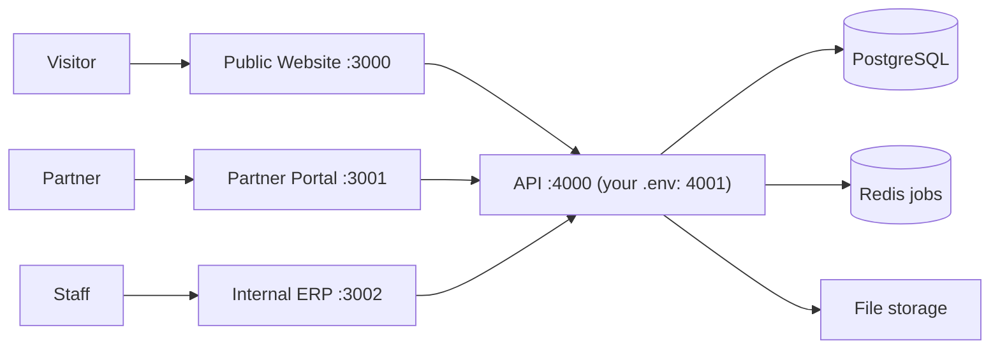

# FIXOTEC ONE: Complete User Guide

This guide explains how to use every feature of every Fixotec app, as it works in the code today. Read it before demonstrating Fixotec. When it mentions something that has not been built yet, it marks it **Roadmap**. Don't promise those features as live.

## What Fixotec ONE is

Fixotec ONE is an industrial ERP and digital platform for Fixotec, a maker of MEP pipe supports, mounting rails, clamps and hangers. It joins three web apps to one shared backend, so one set of data runs the whole business:

> Lead -> Customer -> Project -> RFQ -> Engineering -> BOQ -> Quotation -> Approval -> Sales Order -> Production / Purchase -> QC -> Warehouse -> Dispatch -> Invoice -> Payment -> Support -> Analytics

| App | Who uses it | Local URL | Code folder |
|---|---|---|---|
| Public website | Anyone (visitors, prospects) | http://localhost:3000 | `apps/web` |
| Partner portal | Customers/contractors, distributors/dealers, consultants | http://localhost:3001 | `apps/portal` |
| Internal ERP | Fixotec staff | http://localhost:3002 | `apps/erp` |
| API (backend) | All three apps | http://localhost:4000 (your local `.env` uses **4001**) | `apps/api` |
| API docs (Swagger) | Developers | http://localhost:4000/api/docs | `apps/api` |

## Demo logins

Every demo account uses the same password: **`ChangeMe!234`**. It comes from `SEED_ADMIN_PASSWORD` in `.env`.

### Staff accounts (sign in to the ERP at :3002)

| Email | Person | Role | Good for demonstrating |
|---|---|---|---|
| admin@demo.fixotec.test | Demo Admin | super_admin | Everything: users, roles, content, any approval |
| md@demo.fixotec.test | Demo MD | managing_director | Executive dashboard, analytics, every approval |
| saleshead@demo.fixotec.test | Demo Sales Head | sales_head | Leads, RFQs, quotations, 10-20% discount approvals |
| sales@demo.fixotec.test | Demo Sales Executive | sales_executive | Day-to-day sales (cannot approve) |
| engineer@demo.fixotec.test | Demo Design Engineer | design_engineer | Engineering requests, BOQ, drawings |
| purchase@demo.fixotec.test | Demo Procurement Manager | procurement_manager | Vendors, purchases, PO approvals |
| warehouse@demo.fixotec.test | Demo Warehouse Manager | warehouse_manager | Warehouses, inventory, dispatch |
| production@demo.fixotec.test | Demo Production Manager | production_manager | Production, shop floor |
| qc@demo.fixotec.test | Demo QC Manager | qc_manager | Quality inspections, NCRs |
| site@demo.fixotec.test | Demo Site Engineer | site_engineer | Site issues |
| finance@demo.fixotec.test | Demo Finance Head | finance_head | Invoices, payments, expenses, credit hold release, audit |
| hr@demo.fixotec.test | Demo HR | hr | People list with salaries |

### Partner accounts (sign in to the portal at :3001)

| Email | Person | Company | Portal type |
|---|---|---|---|
| customer@apexmep.example | Aditi Rao | Apex MEP Contractors | Contractor / customer |
| distributor@westline.example | Imran Sheikh | Westline Building Systems | Distributor (dealer price list) |
| consultant@northstar.example | Devika Sen | Northstar Consulting | Consultant |

The public website has no login. In demo mode it may ask for an HTTP password: the username is `fixotec` and the password is the `DEMO_PASS` value in `.env`. Locally in development the gate is open when `DEMO_PASS` is empty.

## Contents and suggested study order

| # | File | What you learn |
|---|---|---|
| 0 | [00-setup-and-running.md](00-setup-and-running.md) | Installing, starting, resetting the demo |
| 1 | [01-roles-and-permissions.md](01-roles-and-permissions.md) | Who can see and do what |
| 2 | [02-public-website.md](02-public-website.md) | Every website page, the RFQ basket, the System finder |
| 3 | [03-partner-portal.md](03-partner-portal.md) | Contractor, distributor and consultant portals |
| 4 | [04-erp-basics.md](04-erp-basics.md) | ERP login, layout, dashboard, approvals, assistant |
| 5 | [05-erp-commercial.md](05-erp-commercial.md) | Leads, customers, projects, RFQs, quotations, orders |
| 6 | [06-erp-engineering.md](06-erp-engineering.md) | Engineering, BOQ, products, CAD/BIM, submittals, documents |
| 7 | [07-erp-supply-chain.md](07-erp-supply-chain.md) | Vendors, purchases, warehouses, inventory, dispatch |
| 8 | [08-erp-plant.md](08-erp-plant.md) | Production, shop floor, MRP, quality, NCR |
| 9 | [09-erp-field-finance.md](09-erp-field-finance.md) | Site execution, service, invoices, payments, expenses |
| 10 | [10-erp-administration.md](10-erp-administration.md) | Analytics, HR, website CMS, organization, users, roles, audit |
| 11 | [11-business-rules-and-flows.md](11-business-rules-and-flows.md) | Status machines, numbering, automatic flows, integrations |
| 12 | [12-end-to-end-demo-script.md](12-end-to-end-demo-script.md) | Rehearsable demo script with a login for every step |
| 13 | [13-known-limitations.md](13-known-limitations.md) | What is not built or has quirks, and what to avoid |
| 14 | [14-qa-cheat-sheet.md](14-qa-cheat-sheet.md) | Likely client questions with answers |
| 15 | [15-glossary.md](15-glossary.md) | Every abbreviation explained |

**Study plan:**

1. **Day 1:** files 0, 1 and 15. Get the system running and learn the vocabulary.
2. **Day 2:** files 2 and 3. Click through the website and all three portal logins.
3. **Day 3:** files 4 to 7. Go through the ERP with the matching staff login for each module.
4. **Day 4:** files 8 to 11.
5. **Day 5:** files 12, 13 and 14. Rehearse the demo script twice, end to end.

## Conventions used in this guide

- **Bold** text is an exact button or menu label, for example **Generate quotation**.
- `code` text is a URL, a field value, a status or a permission key, for example `/rfqs` or `quotations.approve`.
- "Permission" means the key a user's role must have. See file 1.
- Each module file ends with a **Practice exercise** to do as homework.
